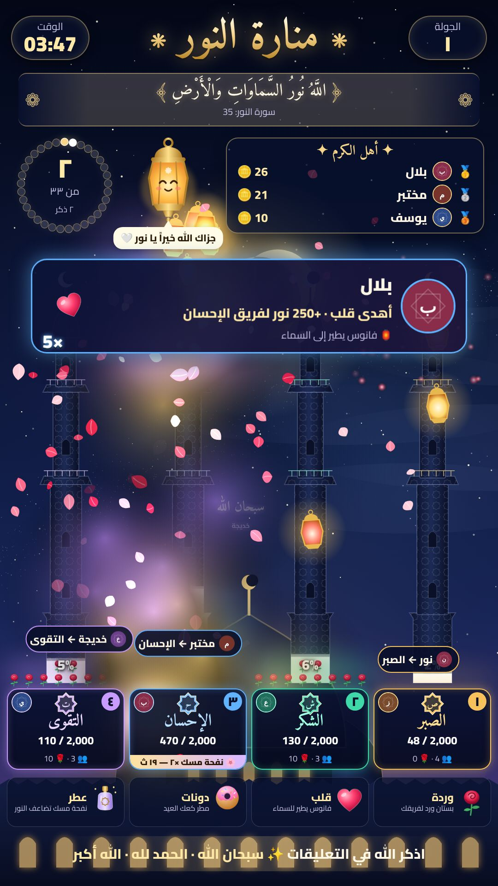
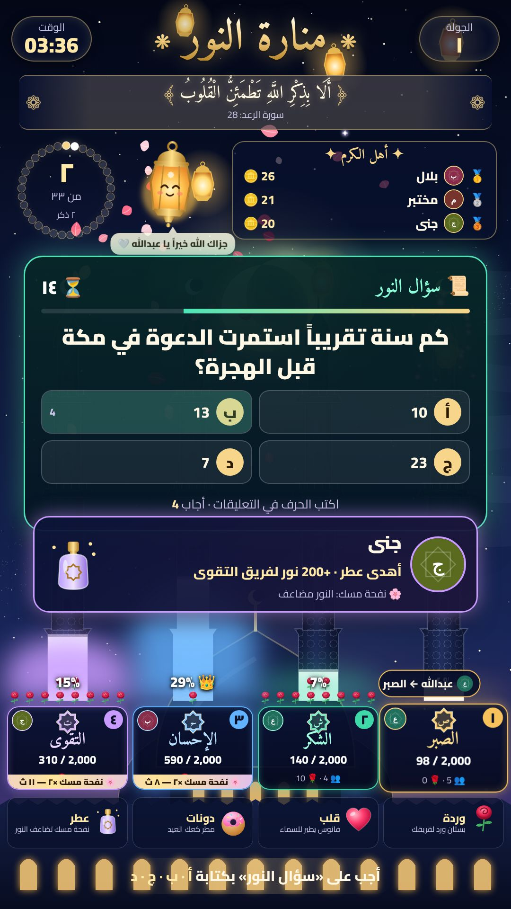
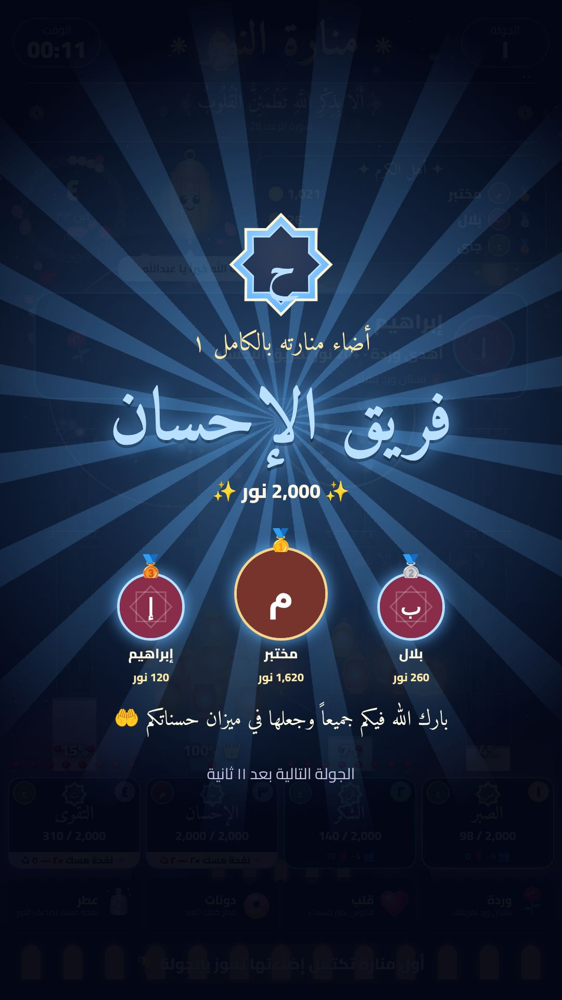
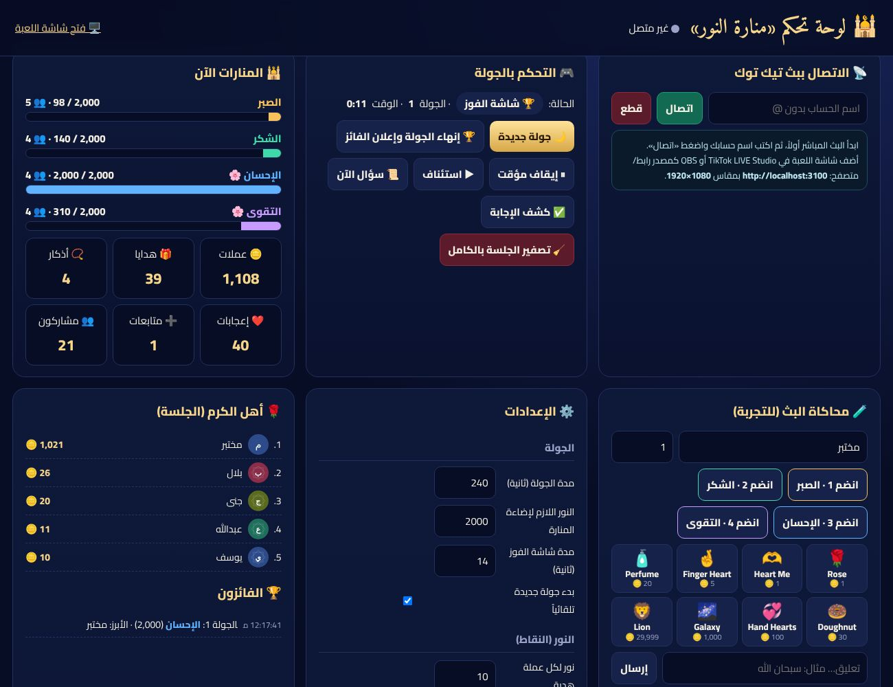

# 🌙 منارة النور — لعبة تيك توك لايف إسلامية تفاعلية

<p align="center">
  
  
  
</p>

**الفكرة:** ليلة رمضانية ساحرة، وفي أسفلها أربع منارات مظلمة لمسجد كبير. كل منارة تمثّل **فضيلة**:
**الصبر · الشكر · الإحسان · التقوى**. المتابعون ينضمّون إلى فرق الفضائل، وكل تفاعل منهم — **ذكر، إجابة صحيحة، إعجاب، مشاركة، هدية** — يملأ منارة فريقهم بالنور من الأسفل إلى الأعلى.
أول منارة تكتمل إضاءتها تفوز بالجولة وسط احتفال من الأضواء والفوانيس والألعاب النورانية، وتظهر صور أبرز الداعمين في الفريق.

### لماذا هي «خارج الصندوق»؟
- **التنافس على الخير وليس على الأشخاص:** الفرق فضائل، والفوز «إضاءة منارة»، فيبقى الجو راقياً.
- **الذكر مجاني ويُحتسب:** كتابة «سبحان الله» في التعليقات تطلق النص بخط نسخي يطير ويتحوّل إلى **نجمة دائمة في السماء**، وتمتلئ **مسبحة الـ33** على الشاشة. مع الوقت تمتلئ السماء بنجوم أذكار المتابعين!
- **كل هدية لها عالمها البصري الخاص** (ليست مجرد نقاط):

| الهدية | ما يحدث على الشاشة |
|---|---|
| 🌹 **وردة** | بتلات ورد تتساقط فوق منارة فريقك، ويتفتّح ورد في **حديقة** عند قاعدتها |
| ❤️ **قلب** (Heart Me / Finger Heart / Hand Hearts…) | **فانوس مضيء** ينطلق من المنارة ويطير ببطء إلى السماء |
| 🍩 **دونات** | مطر من **كعك العيد** المنقوش يتساقط ويرتدّ على الأرض |
| 🧴 **عطر** | **نفحة مسك** ذهبية بنفسجية تعبر الشاشة، ونور فريقك **مضاعف ×2 لمدة 20 ثانية** (الأقوى تكتيكياً!) |
| هدية 99 عملة فأكثر | **شُهب من نور** وعمود ضوء من المنارة |
| هدية 500 عملة فأكثر | **ليلة النور الكبرى:** شفق قطبي، فوانيس في كل مكان، ألعاب نورانية |
| أي هدية أخرى | نجمة جديدة في السماء + نور لفريقك |

- **سؤال النور 📜:** كل 75 ثانية سؤال ديني (46 سؤالاً موثّقاً مدمجاً) بأربعة خيارات، يجيب المتابعون بكتابة **أ / ب / ج / د**، والأسرع يحصل على نور مضاعف وتظهر صورته.
- **«نوري» 🏮:** فانوس رمضاني لطيف بعينين، يرحّب ويشكر كل مُهدٍ باسمه ويقفز فرحاً.
- **شريط آيات وأحاديث** يتجدد كل 20 ثانية (مع المصدر)، منها: «تهادَوا تحابّوا».
- **أهل الكرم:** أكبر 3 داعمين بصورهم في أعلى الشاشة طوال البث — حافز قوي للهدايا.
- **صوت هادئ مولّد بالكامل:** نغمات على **مقام البياتي** بربع تون حقيقي، أو وضع **«طبيعة فقط — بلا آلات»** (نسيم، نافورة، صراصير ليل) لمن يفضّل تجنّب المعازف، أو **نشيدك الخاص**.

---

## 🕹️ كيف يلعب المتابعون (اكتبها في وصف البث)

| ماذا يكتب المتابع | النتيجة |
|---|---|
| `1` أو `2` أو `3` أو `4` (أو اسم الفريق) | الانضمام لفريق الصبر / الشكر / الإحسان / التقوى |
| `سبحان الله`، `الحمد لله`، `الله أكبر`، `لا إله إلا الله`، `أستغفر الله`، `اللهم صل على محمد`… | نجمة في السماء + حبّة في المسبحة + 5 نور لفريقه |
| `أ` / `ب` / `ج` / `د` أثناء السؤال | إجابة سؤال النور |
| ❤️ الضغط على الشاشة | نور صغير، وكل 200 إعجاب يعبر شهاب |
| مشاركة البث | 30 نور + فانوس |
| أي هدية | نور = العملات × 10، مع التأثير الخاص بالهدية |

> من يرسل هدية أو يجيب دون أن ينضم لفريق، يُضمّ تلقائياً لأقل الفرق عدداً حتى تبقى المنافسة متوازنة.

---

## 🚀 التشغيل

**الأسهل:** بعد تثبيت Node.js، اضغط مرتين على `start-noor-windows.bat` (ويندوز) أو `start-noor-mac.command` (ماك). سيثبّت المكتبات أول مرة ويفتح لوحة التحكم تلقائياً.

المتطلبات نفسها كاللعبة الأخرى: **Node.js 20+** و TikTok LIVE Studio أو OBS.

```bash
npm install          # مرة واحدة
npm run noor:demo    # تجربة بمتابعين وهميين بدون بث
npm run noor         # التشغيل الحقيقي
npm run noor -- --user=اسم_حسابك   # مع الاتصال التلقائي بالحساب
```

- **شاشة اللعبة:** <http://localhost:3100> ← أضفها في LIVE Studio / OBS كمصدر **رابط/متصفح** بمقاس **1080 × 1920**
- **لوحة التحكم:** <http://localhost:3100/admin> ← افتحها في متصفحك فقط (لا تضفها للبث)

في OBS فعّل خيار **Control audio via OBS** ليُسمع الصوت. في المتصفح العادي اضغط زر «تفعيل الصوت» مرة واحدة.

| خيارات الرابط | الوصف |
|---|---|
| `?transparent=1` | خلفية شفافة (لوضع اللعبة فوق الكاميرا) |
| `?sound=0` | كتم كل الأصوات |

يعمل الخادم على المنفذ 3100 حتى يمكن تشغيله بجانب لعبة «الضوء الأحمر» (المنفذ 3000). لتغييره: `--port=4000`.

---

## 🎛️ لوحة التحكم

<p align="center"></p>

- **الاتصال ببث تيك توك** وحالته المباشرة.
- **التحكم بالجولة:** جولة جديدة، إنهاء الجولة وإعلان الفائز فوراً، إيقاف مؤقت/استئناف، سؤال الآن، كشف الإجابة، تصفير الجلسة.
- **المنارات الآن:** نور كل فريق وعدد أعضائه، وإحصاءات الجلسة (عملات، هدايا، أذكار، إعجابات، متابعات).
- **محاكاة البث:** أزرار لكل الهدايا (وردة، قلب، عطر، دونات، Galaxy، Lion…) وتعليقات وأذكار وإجابات — لتجربة كل التأثيرات قبل البث.
- **وضع التجربة:** متابعون وهميون يتفاعلون تلقائياً، وزر «دفعة نشاط».
- **الإعدادات** (تُحفظ تلقائياً في `data/noor-settings.json`): مدة الجولة، النور المطلوب للفوز، قيمة كل تفاعل، مدة ومضاعف نفحة المسك، الأسئلة، **أسماء الفرق**، ووضع الصوت ومستواه (يتغيّر على الشاشة فوراً).
- **أهل الكرم، الفائزون، وسجل الأحداث.**

### نشيدك الخاص
ضع ملف صوت باسم `background.mp3` داخل `public/noor/audio/` ثم اختر «ملفي الخاص» من الإعدادات.

### إضافة أسئلة
عدّل `QUIZ` في `src/noor/content.js`. الصيغة: `{ q: 'السؤال', o: ['الصحيحة', 'خطأ', 'خطأ', 'خطأ'], a: 0 }` — الخيارات تُخلط تلقائياً عند العرض.

---

## 💡 نصائح لزيادة التفاعل والأرباح
1. **قسّم البث لجولات قصيرة (3–4 دقائق):** الإحساس بأن المنارة «قريبة من الاكتمال» هو أقوى دافع للهدايا. اضبط «النور اللازم» حسب حجم جمهورك (ابدأ بـ 1000–2000 وارفعه تدريجياً).
2. **عند آخر 15 ثانية** يحمرّ المؤقت وتبدأ دقات خفيفة — نبّه المتابعين: «فريق الشكر يحتاج 200 نور فقط!».
3. **العطر ×2** يصنع لحظات انقلاب درامية؛ اشرحه للمتابعين.
4. **اذكر أسماء «أهل الكرم»** وادعُ لهم بالاسم — مع إبقاء النية لله.
5. **ضع المحتوى المهم أعلى الشاشة:** تعليقات تيك توك تغطي أسفل يسار الشاشة لدى المشاهدين، لذلك المنارات وبطاقات الفرق مصممة لتبقى ظاهرة.

> 🤍 **تنبيه شرعي وأخلاقي:** اللعبة لا تعِد المُهدين بأجر أو ثواب مقابل الهدايا، والهدايا دعم للبث فقط. احرص على ألّا تقول للمتابعين إن الهدية «صدقة» أو تجلب الأجر. الأذكار والأسئلة متاحة مجاناً للجميع، وهي تمنح نوراً كذلك.

---

## 📁 الملفات

```
├── noor-server.js          خادم منارة النور (Express + Socket.IO)
├── src/noor/
│   ├── engine.js           منطق اللعبة: الفرق، النور، الأذكار، الأسئلة، الجولات
│   ├── content.js          الفرق، الهدايا، الأذكار، الآيات والأحاديث، بنك الأسئلة
│   ├── settings.js         الإعدادات الافتراضية وحفظها
│   └── demo.js             متابعون وهميون لوضع التجربة
├── src/tiktok.js           قراءة التعليقات والهدايا (مع معالجة سلاسل الكومبو) والإعجابات والمتابعات
├── public/noor/
│   ├── index.html/noor.css/noor.js   شاشة اللعبة 1080×1920
│   ├── art.js              الرسومات SVG: المنارات، المسجد، أيقونات الهدايا، «نوري»
│   ├── fx.js               السماء والمؤثرات على canvas
│   ├── audio.js            الخلفية الصوتية والمؤثرات (Web Audio)
│   └── admin.html/admin.js لوحة التحكم
└── test/noor.test.js       اختبارات منطق اللعبة
```

`npm test` يشغّل كل الاختبارات.
